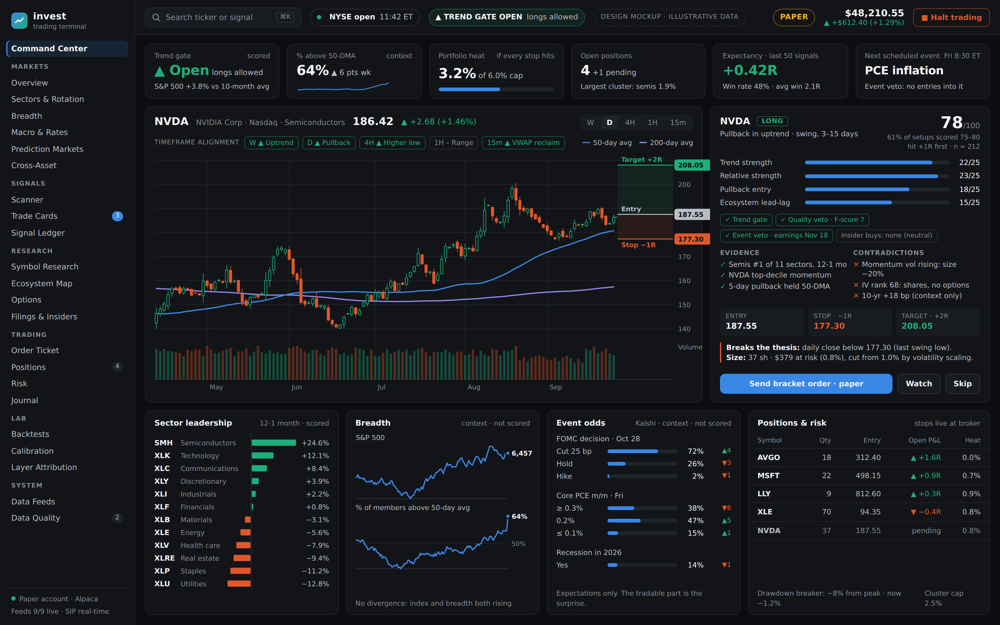

# Site map

*End-state design mockup. Every number in it is illustrative; the live site
shows real data or says plainly that it has none. Source:
[`design/command-center.html`](design/command-center.html), rendered with
`node docs/design/render.mjs`.*

**Status key.** **Live**: built and served by the research API today.
**V1**: next build phase (paid data, signals, validation, paper trading).
**V2**: after V1 has proven itself in paper trading.

The site's navigation is built from `web/src/siteMap.ts`, and a test fails if
this page and that file disagree. Pages marked *context* display data that
never moves a score; the scored inputs are listed in
[ENGINE_INPUTS.md](ENGINE_INPUTS.md).

## Contents

1. [Command Center](#1-command-center)
2. [Markets](#2-markets): Overview · Sectors & Rotation · Breadth · Macro & Rates · Prediction Markets · Cross-Asset
3. [Signals](#3-signals): Scanner · Trade Cards · Signal Ledger
4. [Research](#4-research): Symbol Research · Filings & Insiders · Ecosystem Map · Options
5. [Trading](#5-trading): Order Ticket · Positions · Risk · Journal
6. [Lab](#6-lab): Backtests · Calibration · Layer Attribution
7. [System](#7-system): Data Feeds · Data Quality · Settings

## 1. Command Center

| Page | Status | What it is for |
|---|---|---|
| Command Center | Live | One screen for the day: trend gate, portfolio heat, the best trade cards, open positions, with breadth and event odds as context. Today it shows the macro regime, universe coverage, data quality and research history. |

## 2. Markets

| Page | Status | What it is for | Data |
|---|---|---|---|
| Overview | Live | Every tracked symbol, its sector and data-quality status | Security master, verified against EDGAR |
| Sectors & Rotation | Live | Relative strength (12-1 month) by sector. Scored | Sector fund bars (Stooq now; Norgate in V1.3) |
| Breadth | V1 | Context: % above 50/200-day averages, advance/decline, new highs vs lows | Survivorship-free constituents (Norgate) |
| Macro & Rates | Live | Context: curve, credit, VIX, unemployment, inflation | FRED / ALFRED with vintages |
| Prediction Markets | V2 | Context: odds for FOMC, CPI, PCE, recession, with 24h change | Kalshi, Polymarket |
| Cross-Asset | V2 | Context: dollar, oil, gold, Treasuries, crypto | FRED, ETF proxies, CCXT |

## 3. Signals

| Page | Status | What it is for | Data |
|---|---|---|---|
| Scanner | Live | Every symbol through trend gate → relative strength → pullback entry, plus quality and event vetoes, with the reason it passes or fails | 10/10 inputs only |
| Trade Cards | Live | Entry, stop, target, size, gates and vetoes, the level that breaks the thesis. Paper orders from a card arrive in V1.2 | Signal engine + risk model |
| Signal Ledger | Live | Every setup found, fired or blocked, with its outcome in R after costs and MFE/MAE. Live and backfill kept apart | Append-only ledger tables |

## 4. Research

| Page | Status | What it is for | Data |
|---|---|---|---|
| Symbol Research | Live | Chart, the three scores with every component, fundamentals, insiders, congressional disclosures (firewalled), report, history | Prices, SEC XBRL, Form 4, snapshots |
| Filings & Insiders | V1 | Universe-wide feed of new 8-Ks and insider open-market buys, opportunistic insiders first | EDGAR filing index, Form 4 |
| Ecosystem Map | V2 | Dated customer/supplier links, used to find laggards | 10-K major-customer disclosures |
| Options | V2 | Chain, IV rank, expected move. IV rank picks shares or a spread, never direction | OPRA via Alpaca + Massive history |

## 5. Trading

| Page | Status | What it is for | Data |
|---|---|---|---|
| Order Ticket | V1 | Trade card → bracket order in one step, paper first | Alpaca trading API |
| Positions | V1 | P&L in dollars and R; is each stop live at the broker | Alpaca account |
| Risk | V1 | Heat vs cap, correlated clusters, drawdown breaker, halt switch | Positions + risk model |
| Journal | V2 | Notes and a data snapshot per trade, reviewed against the ledger | Notes + ledger |

## 6. Lab

| Page | Status | What it is for | Data |
|---|---|---|---|
| Backtests | V1 | Point-in-time backtests with costs, walk-forward splits, honest refusals | Existing engine, exposed via API |
| Calibration | Live | Mean R, win rate and +1R-before-−1R by score bucket: does a higher score earn more? | Ledger outcomes |
| Layer Attribution | Live | What each gate and veto blocks versus what it lets through, with t-statistics against a t > 3 bar | Ledger |

## 7. System

| Page | Status | What it is for | Data |
|---|---|---|---|
| Data Feeds | Live | What is stored and how fresh it is; feed health and failover arrive in V1 | Row counts today |
| Data Quality | Live | Everything the validation gate flagged | Validation conflicts |
| Settings | V1 | Which keys are configured (never their values), risk limits, paper/live, sign-in | Server config |
